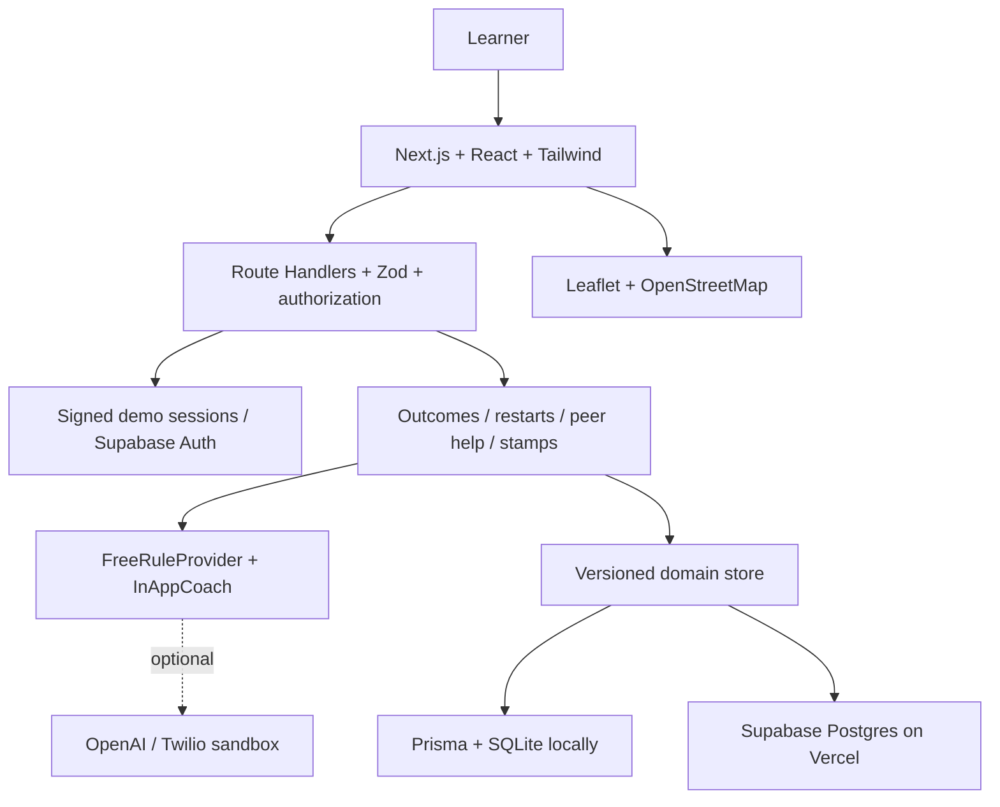

# CampusSignal

**A little momentum. A nearby friend. A way forward.**

CampusSignal helps working open-university learners turn a stalled module into a manageable next step. Built MIVA-first, it combines 12-minute learning tasks, nearby peer support, and collectible Proof Stamps.

[Live demo](https://campussignallive.vercel.app) · [Demo materials](demo-kit/README.md) · [Built with Codex](docs/BUILD_WITH_CODEX.md) · [Local setup](#try-it-locally)

## Why CampusSignal

Amaka works while studying Computer Science. She has been away from her REST and authentication module for six days, and catching up feels overwhelming. CampusSignal helps her choose one confirmed learning outcome, attempt a small task, and record what happened. If she gets stuck, she can ask a nearby learner for help.

The journey connects learning intent to action: **confirm an outcome → take a small step → get support → record progress.**

## Features

- **12-minute restarts:** a focused task with a rubric shown before submission and an optional timer.
- **Confirmed learning outcomes:** paste a module outline or import a text-based PDF, then review and confirm the outcomes before creating a task.
- **Phone a Friend:** find helpers by topic and programme, send a request, and chat after acceptance. Both learners complete independently before earning UNSTUCK stamps.
- **Nearby community:** opted-in peers and study-desk or buddy pins within approximately 1.6 km, using approximate locations.
- **In-app coach:** restart plans, reflection prompts, “stuck” support, and `DONE` evidence submissions in a WhatsApp-style conversation.
- **Proof Stamps:** a persistent collection of completed restarts and shared breakthroughs.
- **Personal learning preferences:** guided onboarding, study rhythm, self-reported strengths, and light/dark/system appearance.

The core experience uses **rule-based AI (no paid keys)**. Optional OpenAI help notes and the Twilio sandbox are separate integrations.

## Try the demo

Open [CampusSignal](https://campussignallive.vercel.app) and choose a learner on the login screen.

| Persona           | Role                                                            |
| ----------------- | --------------------------------------------------------------- |
| **Amaka Okafor**  | Stalled for six days on “REST, Auth & Testing a Node endpoint”. |
| **Tunde Adeyemi** | Nearby helper, approximately 0.4 mi away.                       |
| **Chioma Eze**    | Helper and study-desk host, approximately 0.6 mi away.          |

### Demo accounts and 90-second path

1. Sign in as **Amaka**, open Coach, and send **stuck**.
2. Open **Phone a Friend** and request Tunde’s help with a REST authentication problem.
3. Use **Switch persona** to become **Tunde**. Open Phone a Friend, accept the request, exchange a message, and mark your side complete.
4. Switch back to **Amaka**, open the session, and mark her side complete.
5. Open **My stamps**. Both learners have earned **UNSTUCK**.

For a shorter restart journey, open Amaka’s restart task, read the rubric, and submit:

> I built a REST endpoint and the test returned a 200 response with the expected JSON.

Evidence meeting all three rubric checks earns **The comeback** stamp. The timer does not gate submission.

The [demo kit](demo-kit/README.md) includes a module-outline PDF, printable walkthrough, and copy-and-paste content. Demo personas share persistent state; use demonstration content only. Separate browser profiles can show both learners at once; ordinary tabs share the same login.

## Built with Codex

CampusSignal is developed with Codex assistance, guided by the [product brief](CODEX_PROMPT.md), [repository instructions](AGENTS.md), and project design skills. Codex has been used in this repository for code inspection, cleanup, documentation, and validation.

The [Codex build record](docs/BUILD_WITH_CODEX.md) documents observed work, links implementation and tests, and distinguishes available evidence from earlier work whose authorship is not established by this conversation.

Codex assists development; the application runs its default learning workflows through deterministic rules without an OpenAI API key.

## Architecture

One Next.js App Router application serves both the interface and API.



Local and hosted storage persist the same typed domain collections in a private versioned aggregate. Writes use optimistic concurrency. API routes enforce ownership, consent, and help-session participation. This storage model supports a small pilot; larger deployments will need normalized, indexed tables.

## Try it locally

Requires **Node.js 22+** and npm.

```sh
cp .env.example .env
```

Generate a secret with `openssl rand -hex 32` and set it as `SESSION_SECRET` in `.env`. Keep `DEMO_LOGIN="1"` and leave Supabase, OpenAI, and Twilio variables empty for the local demo.

```sh
npm install
npm run db:push
npm run seed
npm run dev
```

Open [localhost:3000](http://localhost:3000) and choose Amaka. The example configuration stores data in `prisma/dev.db`.

**Reset:** `npm run seed` replaces all data in the configured store. Use it only with a disposable demo database. A locally run seed script can affect hosted data when Supabase variables are configured.

### Configuration and deployment

| Variable                                                    | Purpose                                                                                    |
| ----------------------------------------------------------- | ------------------------------------------------------------------------------------------ |
| `DATABASE_URL`                                              | Local SQLite connection; defaults to `file:./dev.db`.                                      |
| `DEMO_LOGIN`                                                | `1` enables shared personas; `0` disables them for private deployments.                    |
| `SESSION_SECRET`                                            | Random secret of at least 32 characters for demo sessions.                                 |
| `NEXT_PUBLIC_APP_URL`                                       | Application origin for authentication callbacks and webhook validation.                    |
| `NEXT_PUBLIC_SUPABASE_URL`, `NEXT_PUBLIC_SUPABASE_ANON_KEY` | Supabase project URL and public key for real email authentication.                         |
| `SUPABASE_SERVICE_ROLE_KEY`                                 | Server-only key for hosted persistence. Never expose it through a `NEXT_PUBLIC_` variable. |

CLI scripts load `.env` or exported variables; they do not automatically load `.env.local`.

For **Vercel + Supabase**, apply [the hosted schema](supabase/schema.sql), configure all three Supabase variables, and initialize an empty demo store with the seed script. Set the deployed origin in `NEXT_PUBLIC_APP_URL` and allow its `/auth/callback` URL in Supabase Auth. Configure email delivery before offering real signups. Keep `DATABASE_URL=file:./dev.db` for Prisma generation; hosted runtime persistence uses Supabase. SQLite is local only.

See the [deployment checklist](docs/SUBMISSION.md#deploy-today) for the full sequence.

### Optional integrations

- **OpenAI:** `OPENAI_API_KEY` and optional `OPENAI_MODEL` enable help-note enrichment with rule-based fallback. Outcome extraction, task creation, and scoring remain deterministic.
- **Twilio sandbox optional:** configure `TWILIO_ACCOUNT_SID`, `TWILIO_AUTH_TOKEN`, and `TWILIO_WHATSAPP_FROM`. The `/api/whatsapp/twilio` webhook verifies signatures and acknowledges messages. Account linking and full WhatsApp task conversations are not implemented; the in-app coach provides the complete default flow.

## Validation

```sh
npm test
npm run typecheck
npm run format:check
npm run build
```

Tests cover consent and privacy, learning preferences, helper matching, scoring, bilateral completion, duplicate-stamp prevention, authentication callback handling, and client-cache behavior.

For API integration checks, start a seeded, disposable local server with Supabase variables empty, then run `npm run test:api`. This changes demo data, including help sessions and blocks. Use `npm start` to serve a production build, and `npm run format` to apply formatting.

## Privacy and scope

Discovery and helping are opt-in. Coordinates are rounded to approximately 100 m; the app does not request GPS. Blocking restricts discovery and session access. New real accounts begin with discovery and helping disabled.

Proof Stamps record engagement, not academic correctness or accredited competence. Stall signals reflect activity recorded in CampusSignal. Phone a Friend is an in-app peer conversation.

PDF extraction runs in the browser, supports selectable text up to 5 MB / 40 pages, and imports up to 15,000 characters. Files are not uploaded. Scanned PDFs require pasted text. Evidence photos are optional HTTPS references; image analysis is not included.

The MVP does not include LMS scraping, payments, a job board, background notifications, self-service account export/deletion, or staffed moderation. Reports are recorded for operator review. See [privacy and data handling](docs/PRIVACY.md).

## Documentation

- [Product and learner flows](docs/PRODUCT.md)
- [Codex build record](docs/BUILD_WITH_CODEX.md)
- [Demo materials](demo-kit/README.md)
- [API reference](docs/API.md)
- [Privacy](docs/PRIVACY.md)
- [Design system](docs/DESIGN.md) and [brand](docs/BRAND.md)
- [Deployment and release checklist](docs/SUBMISSION.md)
- [Contributing](CONTRIBUTING.md)
