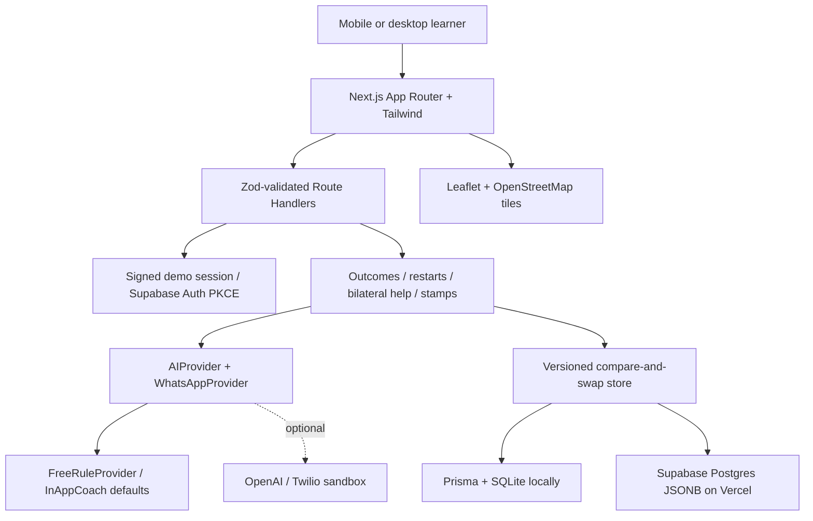

# CampusSignal

**A little momentum. A nearby friend. A way forward.** CampusSignal helps working open-university learners find their next small win after stalling mid-module. Built MIVA-first, with one Next.js App Router + TypeScript + Tailwind application for UI and API.

Working learners do not always need another course or another chatbot. Sometimes they need a manageable restart, someone close by who understands the problem, and proof that their effort counts.

## Try it locally

Requires Node.js 22+ and npm. No paid key is needed.

```sh
cp .env.example .env
npm install
npm run db:push
npm run seed
npm run dev
```

Set SESSION_SECRET to a random string of at least 32 characters. Open [CampusSignal locally](http://localhost:3000). Hosted demo: [CampusSignal](https://campussignallive.vercel.app).

### Demo accounts and 90-second path

`DEMO_LOGIN=1` exposes three shared personas, without an email address:

- **Amaka Okafor** — stalled for six days on “REST, Auth & Testing a Node endpoint”.
- **Tunde Adeyemi** — nearby helper, approximately 0.4 mi away.
- **Chioma Eze** — helper and study-desk host, approximately 0.6 mi away.

Sign in as Amaka → see the stalled home → open Coach → send “stuck” → Phone a Friend → ask Tunde for help → switch persona to Tunde → Phone a Friend → accept the request → chat → mark complete → switch back to Amaka → mark complete → open My stamps to see UNSTUCK. The app never completes someone else’s side of a session.

Alternate: Amaka → Let’s restart → read the rubric → submit “I built a REST endpoint and the test returned a 200 response with the expected JSON.” → collect The comeback stamp. The timer is optional; it never gates submission.

For a fresh module: paste an outline → review/edit extracted source lines → explicitly confirm outcomes → receive a task based on the first confirmed outcome. No task is generated from unconfirmed outcomes.

## Tracks → features

| Track                  | Feature                                                                        |
| ---------------------- | ------------------------------------------------------------------------------ |
| Learner success        | Stall detection, 12-minute restarts, rubric before submission, Proof Stamps    |
| Community              | Leaflet/OpenStreetMap, opted-in peers and desk/buddy pins, Phone a Friend      |
| Accessible AI          | Rule-based AI (no paid keys), optional OpenAI topic hints                      |
| Trust                  | Approximate location, reciprocal opt-ins, ownership checks, block/report tools |
| Conversational support | Persistent in-app WhatsApp-style coach; Twilio sandbox optional                |

## Screenshots

Screenshot placeholders for a deployed judging submission:

- `docs/screenshots/home.png` — Amaka’s stalled dashboard.
- `docs/screenshots/nearby.png` — approximate map and nearby helpers.
- `docs/screenshots/help.png` — accepted help session and bilateral completion.
- `docs/screenshots/stamps.png` — earned restart and UNSTUCK stamps.

## Architecture



The domain entities are User, ModuleOutline, Outcome, StallState, RestartTask, Submission, ProofStamp, MapPin, HelpRequest, HelpSessionMessage, and CoachMessageLog. Types are in `lib/domain.ts`; the MVP stores these as collections in one private versioned aggregate. This is a deliberate small-pilot design, not a normalized relational schema. Hosted writes use optimistic concurrency; every API request authorizes access before returning records. Normalized tables are the next scaling step.

## Free-tier setup and deployment

**Local:** Prisma + SQLite, signed demo cookies, deterministic AI. `npm run db:push` initializes the database. `npm run seed` resets the configured store to the three personas.

**Vercel + Supabase:** create a free Supabase project, run `supabase/schema.sql` in its SQL editor, then set `NEXT_PUBLIC_SUPABASE_URL`, `NEXT_PUBLIC_SUPABASE_ANON_KEY`, and `SUPABASE_SERVICE_ROLE_KEY`. Keep the service key server-side. Run the seed script against this configuration once for a demo. Deploy this repository as a Next.js app on Vercel with the same environment variables, a strong SESSION_SECRET, and NEXT_PUBLIC_APP_URL set to the deployed origin. Set DATABASE_URL to `file:./dev.db` for Prisma generation; hosted runtime uses Supabase, never ephemeral SQLite. Local disk persistence is deliberately rejected on Vercel if Supabase is missing.

In Supabase Auth, enable email signup, set the Site URL, and allow `https://YOUR-DOMAIN/auth/callback` (plus localhost for development). Magic-link signup uses PKCE. New users have discovery and helper opt-ins off and should set their profile area before opting in. Supabase’s included email delivery has restrictions and quotas; broader public signup may require a supported custom SMTP service. Check your project’s Auth email settings before sharing a signup link.

PDF module import extracts text locally in the browser (5 MB / 40 pages, up to 15,000 characters). Learners review text and explicitly confirm outcomes. Scanned PDFs need pasted text; OCR is not included. No PDF files are uploaded. Evidence supports written notes and optional HTTPS photo URLs. Supabase Storage is a planned extension for authenticated uploads, not required to use the app.

### Optional providers

- **OpenAI:** set OPENAI_API_KEY and optionally OPENAI_MODEL. Only help-topic hints use OpenAI; extraction, task creation, and scoring remain deterministic. Failed external hints fall back to FreeRuleProvider. OpenAI usage may incur charges; leave the key empty for the free path.
- **Twilio sandbox optional:** set TWILIO_ACCOUNT_SID, TWILIO_AUTH_TOKEN, TWILIO_WHATSAPP_FROM, and NEXT_PUBLIC_APP_URL. Point the sandbox incoming webhook at `/api/whatsapp/twilio`. It verifies the Twilio signature and returns a TwiML acknowledgement directing users to the in-app coach. Phone-to-account linking and full inbound WhatsApp task events are out of scope for this stub. The TwilioWhatsAppSandbox provider includes outbound send support for a future linked-account integration. The in-app coach is the complete default conversation flow.

| Constraint                | Implementation / limit                                                             |
| ------------------------- | ---------------------------------------------------------------------------------- |
| No paid services required | Local demo and rule-based AI need no external keys                                 |
| Vercel free deployment    | Supabase persistent store; never SQLite on ephemeral serverless disk               |
| Privacy                   | Opt-in discovery/help, ~100 m coordinate rounding, no exact GPS                    |
| Honest outcomes           | Extracted from pasted text; learner confirms edits before task creation            |
| Honest stamps             | Evidence checks, not accredited proof of competence; repeated calls are idempotent |
| Human help                | Recipient accepts; both participants complete independently                        |
| Shared demos              | Public persona data; disable demo login for private use                            |
| Small pilot               | Single versioned aggregate; no distributed rate limiting or staffed moderation     |
| Maps                      | Free OSM tiles need network access; visible peer list remains available            |

## Scripts

| Command                       | Purpose                                                                 |
| ----------------------------- | ----------------------------------------------------------------------- |
| `npm run dev`                 | Start development server                                                |
| `npm run db:push`             | Initialize local SQLite schema                                          |
| `npm run seed`                | Replace configured data with demonstration personas — destructive reset |
| `npm test`                    | Domain privacy, scoring, lifecycle, idempotency tests                   |
| `npm run typecheck`           | TypeScript validation                                                   |
| `npm run build` / `npm start` | Production build / server                                               |

## Documentation

[Product](docs/PRODUCT.md) · [Judge brief](docs/JUDGES.md) · [API examples](docs/API.md) · [Privacy](docs/PRIVACY.md) · [Contributing](CONTRIBUTING.md) · [Agent rules](AGENTS.md)

Framework references used during implementation: [Next.js App Router](https://nextjs.org/docs/app) and [Supabase PKCE code exchange](https://supabase.com/docs/reference/javascript/auth-exchangecodeforsession).

## Out of scope

No LMS or paywall scraping, job board, grades, payments, automatic academic correctness assessment, exact GPS, live video calling, production WhatsApp account linking, automatic image analysis, background notifications, or staffed report escalation. Phone a Friend is an in-app peer-help conversation, not a telephone call.

## Design system

Self-hosted Archivo, Inter, Geist Mono, and Instrument Serif typography; persistent light/dark/system themes; restrained Motion animations and landing-only Lenis scrolling. Phone a Friend introduces the editorial, ruled layout. See [docs/DESIGN.md](docs/DESIGN.md) and the project design/Motion skills in `.agents/skills`.

## Account setup and personalized learning

New real accounts begin with four-step onboarding for studies, modules, goals, study preferences, self-reported strengths, and approximate area. Discovery and helping remain opt-in. Revisit Learning preferences from Home or Profile. Phone a Friend ranks eligible helpers by matching topics/strengths and programme. The rule-based coach offers contextual plans and reflection prompts based on confirmed tasks, with no paid keys. See [submission handoff](docs/SUBMISSION.md) for deployment and the judging walkthrough.
